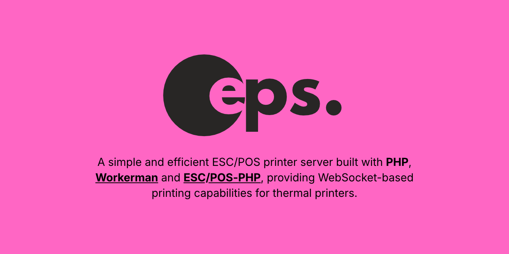
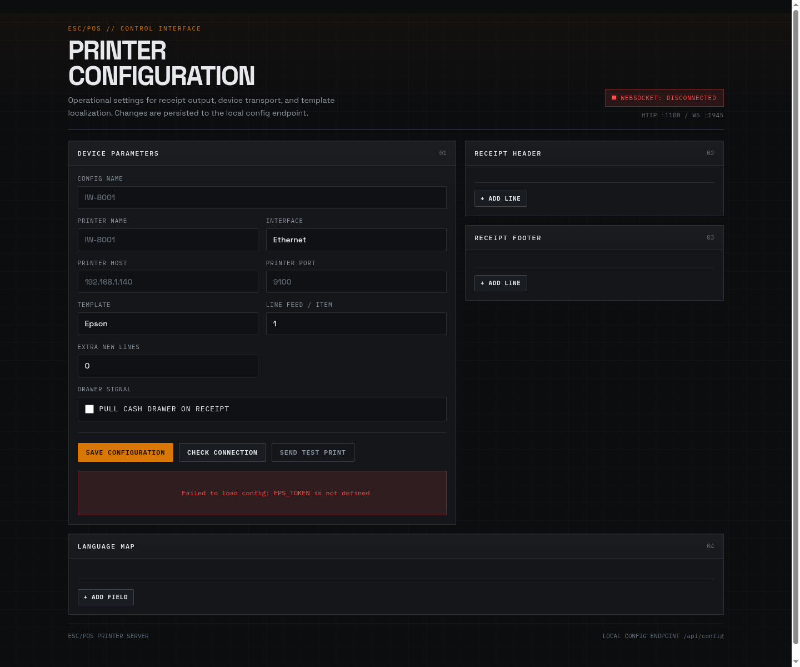

<p align="center">
    
</p>

<p align="center">
  A simple and efficient ESC/POS printer server built with PHP (&gt;= 8.3),
  <a href="https://github.com/walkor/workerman" target="_blank">Workerman</a>,
  and <a href="https://github.com/mike42/escpos-php" target="_blank">ESC/POS-PHP</a>
  for WebSocket-based thermal receipt printing.
</p>

<p align="center">
  <a href="https://saweria.co/darkterminal" target="_blank"></a>
  <a href="https://github.com/sponsors/darkterminal" target="_blank"></a>
  
  
  
  
</p>

## Overview

ESC/POS Printer Server bridges your web or POS application and a thermal printer over WebSocket. It ships with a built-in Web GUI for printer configuration and printer checks.

<p align="center">
  
</p>

## Documentation

Read the full documentation and user manual here:

- **Landing page:** [darkterminal.github.io/escpos-printer-server](https://darkterminal.github.io/escpos-printer-server/)
- **User manual:** [darkterminal.github.io/escpos-printer-server/user-manual](https://darkterminal.github.io/escpos-printer-server/user-manual/)

The documentation covers installation, Windows usage, authentication, WebSocket protocol, and payload validation.

## Quick Start

### Linux / macOS

```bash
curl -fsSL https://raw.githubusercontent.com/darkterminal/escpos-printer-server/main/scripts/install.sh | bash
cd ~/.local/share/escpos-printer-server
./eps --role http
```

### Windows

1. Download the `eps-windows-bundle` archive from the [Releases](https://github.com/darkterminal/escpos-printer-server/releases) page.
2. Extract it somewhere on your system.
3. Run `eps-install.bat` to install and start the `EPS-WS` and `EPS-HTTP` services via NSSM.
4. To uninstall, run `eps-uninstall.bat`.

After install/start:

- Web GUI: `http://localhost:1100`
- WebSocket: `ws://localhost:1945`

## Build from Source

```bash
git clone https://github.com/darkterminal/escpos-printer-server.git
cd escpos-printer-server
composer install
composer run create:phar
```

For detailed build, bundle, protocol, and integration guides, use the [User Manual](https://darkterminal.github.io/escpos-printer-server/user-manual/).

## Contributing

Read [CONTRIBUTING.md](CONTRIBUTING.md) before contributing. By participating, you agree to uphold the [Code of Conduct](CONTRIBUTING.md#code-of-conduct).

## License

Released under the [MIT License](LICENSE). See [CHANGELOG.md](CHANGELOG.md) for release history.
